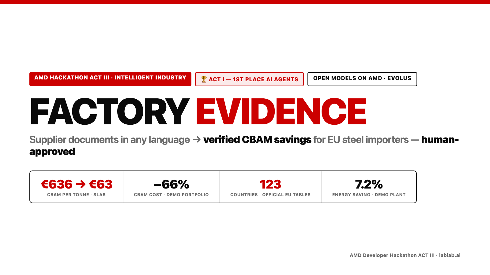

# Factory Evidence

**Supplier documents in any language → verified CBAM savings for EU steel importers. The model reads, rules decide, a person approves.**

Built for the AMD Developer Hackathon: ACT III (lablab.ai) · Track 1 — Intelligent Industry · Evolus Business Agents on AMD.



## The problem

Since 1 January 2026 the EU Carbon Border Adjustment Mechanism (CBAM) charges every tonne of imported steel, aluminium,
cement and fertiliser for its embedded emissions. If the foreign installation cannot prove its emissions, the importer must
use the EU **default value**, plus a mark-up that rises from 10 % (2026) to 20 % (2027) and 30 % (2028+).

| Slab (CN 7207 11 14), 2026 | EU default | With verified supplier data* |
|---|---:|---:|
| Indonesia | **€636 / t** | **€63 / t** |
| India | €277 / t | €84 / t |
| China | €177 / t | — |

*Computed from the official European Commission tables (default values 06.08.2026, benchmarks 06.02.2026), CBAM factor 0.975,
2026 certificate price €82.32, actual emissions as stated in the (synthetic) supplier documents in `data/samples`.

The evidence usually exists — but it is buried in supplier certificates, scans and email threads in Chinese, Turkish,
Indonesian, Ukrainian or Vietnamese. Italian buyers already call the defaults "unworkable".

## What it does

1. **Read** — an open model served on AMD reads the supplier document (scan, photo or PDF page) in any language and returns
   every field with the **verbatim line it came from**. No quote, no value.
2. **Check** — deterministic rules, not the model, validate each value against the official EU tables:
   accredited verification, plausibility versus the EU benchmark of the production route, arithmetic (total ÷ volume),
   reporting period, country of origin.
3. **Decide** — every document ends in one of three outcomes: **ACCEPT**, **NEEDS SUPPLIER** (missing / unverified data),
   **NEEDS HUMAN** (contradiction or implausible value). Nothing is accepted automatically when the numbers don't add up.
4. **Act** — the **Evolus agent "CBAM Supplier Follow-up"**, running on the space's own model (Gemma-4-31B-IT on AMD), writes the
   request to the supplier **in the supplier's language** from the validator's facts and a CBAM rules knowledge library. The Evolus
   AI Tool **anonymize** removes personal data from the evidence file for the auditor. **A person approves** every request in the app.
5. **Count** — € exposure per supplier and for the whole quarter: EU default vs. verified evidence vs. potential if pending
   suppliers verify.

Module B — **Transizione 5.0 energy evidence**: a baseline regression (production, weather, hour of week; IPMVP Option C style)
measures the saving of an efficiency retrofit with a 95 % interval and checks the 3 % / 5 % thresholds, then drafts the note
for the certified energy manager (EGE). No language model in the numbers.

## Demo

- Live demo (recorded from live AMD runs): https://factory-evidence.netlify.app
- Run locally in one command: `docker build -t factory-evidence . && docker run -p 8080:8080 --env-file .env factory-evidence`
  then open http://localhost:8080. Without keys the app runs on bundled demo data and says so ("DEMO DATA" badge).

## How it is built

```
supplier scan ──► open vision model on AMD (Token Factory, OpenAI-compatible) ──► fields + verbatim evidence
                                                                                     │
official EU tables (EC Excel, parsed) ──► CBAM calculator ◄── deterministic validator ┘
                                               │
                    € per tonne · decision ────┼──► Evolus agent on the AMD model (facts only) ──► request in the supplier's language
                                               ├──► Evolus AI Tool "anonymize" ──► evidence file for the auditor
                                               ├──► person approves (recorded, never automatic)
                                               └──► portfolio view · AMD inference panel (latency, tok/s, pages/min)
```

| Part | Where |
|---|---|
| CBAM calculator (official EC default values for 123 countries + benchmarks) | `backend/fea/cbam/calculator.py`, `scripts/build_cbam_tables.py` |
| Deterministic validator | `backend/fea/cbam/validator.py` |
| Document extraction (vision, evidence per field) | `backend/fea/extract/cbam_doc.py` |
| Supplier letters (facts from the validator only) | `backend/fea/extract/letters.py` |
| Evolus client (agent via OpenAI-compatible endpoint, AI Tools, workflows) | `backend/fea/evolus.py` |
| Live benchmark (accuracy, decisions, latency, Evolus calls) | `scripts/bench_live.py` → `results/` |
| Knowledge library document for the Evolus agent | `docs/evolus/CBAM_supplier_evidence_rules.pdf` |
| Energy baseline (Transizione 5.0) | `backend/fea/energy/baseline.py` |
| API + UI | `backend/fea/server.py`, `web/index.html` |
| Synthetic supplier documents (6 languages) + truth files | `data/samples/`, `scripts/make_samples.py` |

### AMD
Every model call goes to **Gemma-4-31B-IT served on AMD** through AMD Token Factory (OpenAI-compatible endpoint): document
reading in the app, and the Evolus agent, whose "own model" is the same AMD endpoint. Confidential trade data never goes to a
closed API. The UI shows a live AMD inference panel (latency per page, tokens per second).

### Evolus (Business Agents on AMD)
- **Own model on AMD:** the Evolus space connects to the AMD endpoint (OpenAI-compatible, all Evolus connection tests passed).
- **Agent "CBAM Supplier Follow-up"** on that model writes every supplier request, called from the app through the Evolus
  OpenAI-compatible endpoint (`model = <applicationId>:<agentId>`).
- **Knowledge library** "CBAM Supplier Follow-up": the rules the validator applies (formula, factors, decision rules, sources).
- **AI Tool "anonymize"**: personal data removed from the evidence file before it goes to the auditor (GDPR).
- **Hand-off to a person:** NEEDS HUMAN documents are never auto-accepted; every supplier request needs a person's approval.

## Measured (live, 16.10.2026)

Reproduce with `python3 scripts/bench_live.py` (results saved in `results/bench_live_*.json`). Synthetic documents, fictional companies.

| What | Result |
|---|---|
| Field accuracy · 6 documents · 6 languages | 65/66 (98.5%) last run · 92.4–98.5% over 5 full runs |
| Decisions · false accepts | 6/6 last run · **0 false accepts in 30 documents** |
| Model misread a CN code | 3 of 30 reads · caught by the rules every time · never auto-accepted · 1 fixed by a rules-guided re-read |
| Latency, shared AMD endpoint | median 19–55 s per page · 6 documents in 54–109 s (4 in parallel) |
| Evolus | 3/3 supplier requests written by the agent on the AMD model · 9/9 Evolus API calls OK |
| Cost | 108 Token Factory requests on 16.10 used 0.0031 of the 1-point daily cap |

## Run and test

```bash
cp .env.example .env              # AMD_TF_API_KEY, AMD_TF_BASE_URL, AMD_TF_MODEL / AMD_TF_VISION_MODEL, EVOLUS_*
pip install -r requirements.txt
cd backend && python -m pytest -q # 34 tests: calculator vs verified model, validator rules, parsing, API, energy
python -m uvicorn fea.server:app --port 8080 --app-dir backend
```

## Honest limits

- Supplier documents and the energy meter data in this repo are **synthetic**; company names are fictional.
- € figures use the official EU default values and benchmarks; certificate prices after 2026 are scenarios, not forecasts.
- The tool prepares evidence; the CBAM declaration and the Transizione 5.0 certification remain the responsibility of the
  authorised declarant, the accredited verifier and the EGE.

## License

MIT
